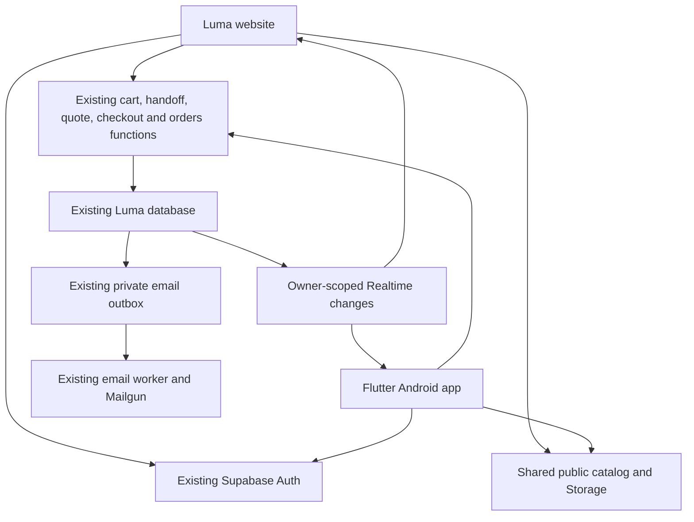

# Luma Shop: Android Flutter research and proposed plan

Research and setup verification date: 2 October 2026, Africa/Lagos. Status: Android implementation authorized and built in the isolated `codex/luma-android` worktree. Flutter and Android tooling are verified. Native app and web synchronization source are implemented; Realtime backend activation is now verified; web deployment and physical-device acceptance remain pending.

## Outcome and scope

Build a Flutter Android app for portfolio demonstration and testing on the user's Android phone. Use the existing Luma Supabase backend so the website and Android app share catalog records, signed-in carts, and demo orders. Keep the current demo behavior: no payment, no shipment, fictional delivery details, and confirmation email through the existing server outbox.

The user initially requested Android and iOS, then selected Android only. iOS development, Apple software, signing, and store publishing are outside this first release. Keep Dart business logic independent of Android-specific configuration so a later iOS client can reuse it.

Success means an item added while signed in on the website appears in the app, and an order placed in the app appears in the website's account history, using the same Google account. Both active clients should refresh automatically after relevant changes. Backgrounded or disconnected clients catch up when resumed or reconnected.

## Evidence from the current repository

The website is Vite with vanilla JavaScript, not a Next.js or React app. Its JavaScript UI cannot be imported into Flutter; screens and client behavior need to be implemented in Dart. The backend can be reused.

| Existing component | Mobile use |
| --- | --- |
| `src/shop/catalog.js` | Match its active catalog query across products, categories, images, and variants. Keep the existing identifiers and integer kobo prices. |
| `src/shop/api.js` | Implement the same HTTP methods, request fields, authenticated headers, response models, and error codes in Dart. |
| `src/shop/auth.js` | Preserve Google authentication and guest cart handoff/recovery semantics. |
| `src/shop/auth-state.js` | Preserve pending checkout identity and guest recovery across interruptions, using suitable Android persistence. |
| `supabase/functions/_shared/auth.ts` | The server validates every bearer token. Quote, checkout, orders, and handoff redemption require a confirmed Google identity. |
| `supabase/functions/_shared/service.ts` | Reuse transactional cart revisions, handoffs, checkout idempotency, order ownership, and the email outbox. |
| `supabase/migrations/20260930115845_luma_shop.sql` | Public catalog and owner-scoped read policies already exist. Private cart/order writes go through server handlers. |
| `public/images/luma/` and the `luma-catalog` Storage bucket | Reuse illustrations and Storage paths. |

The operations guide identifies the dedicated Luma project as `xiunfinvgxoquxiqnnyj`. Confirm this against the actual web environment and live project before connecting the app. This research inspected repository source and official documentation; it did not prove live provider readiness or inspect customer records.

No repository migration currently enables a Realtime publication. Check the live publication before adding one: dashboard configuration can differ from source.

## Recommended architecture

Use a real Flutter UI with one shared backend. A separate mobile database or a data-copying job would introduce unnecessary divergence. A WebView would reuse the web UI but would not deliver the Flutter experience requested.

Proposed location: `mobile/luma_shop/` in this repository, with its own `pubspec.yaml`, committed `pubspec.lock`, Android configuration, and Flutter tests. This keeps web, backend contracts, and sync changes reviewable together. Retain the existing Vite build entries; Flutter output must not enter tracked web `dist/`.

Use feature folders for catalog, authentication, cart, checkout, and orders; shared folders for API models, session storage, money formatting, routing, and the Luma theme. Keep service access outside widgets so logic can be tested independently. Add mobile build/cache/signing ignore rules and update `AGENTS.md` when this architecture is actually implemented.

## Installation checklist

The earlier inspection found macOS 26.7.1, an Intel Core i5, 16 GB RAM, and approximately 308 GiB available disk space. The user subsequently installed Android Studio, SDK components, and editor plugins. The following inventory was verified on 2 October 2026 after installing the downloaded Flutter archive.

| Component | Verified installation |
| --- | --- |
| Flutter | Stable 3.47.6, framework revision `5fc346839b`, at `/Users/dayjigud/develop/flutter`. Installed from `/Users/dayjigud/Downloads/flutter_macos_3.47.6-stable.zip`; bundled Dart executable is Intel/x86_64. |
| Dart / DevTools | Dart 3.13.5 (`macos_x64`) and DevTools 2.60.0. Both version commands succeed in a fresh Zsh login session. |
| Zsh PATH | One `export PATH="$HOME/develop/flutter/bin:$PATH"` entry in `/Users/dayjigud/.zprofile`. Original profile backed up as `/Users/dayjigud/.zprofile.before-flutter-20261002-130642`. |
| Android Studio | `/Applications/Android Studio.app`, 2026.2.1 configuration, build `262.9437.185.2621.16467767`. |
| Java | Android Studio's bundled OpenJDK 25.0.3; Flutter selects `/Applications/Android Studio.app/Contents/jbr/Contents/Home/bin/java`. A separate JDK installation is not currently required. |
| Android SDK | `/Users/dayjigud/Library/Android/sdk`; platforms `android-36` and `android-37.0` (revision 2 each), Build-Tools 36.0.0, Command-line Tools 23.0, Platform-Tools 37.0.1, Emulator 37.2.12, API 36/37.0 sources, and API 37.0 x86_64 Google Play system image revision 6. |
| Native build tools | CMake 4.1.2 and NDK 30.0.16248370 installed. App explicitly selects NDK 30; initial debug/release builds passed. Plugin Gradle projects separately provisioned NDK 28.2.13676358, API 35 and CMake 3.22.1. Keep both NDK versions installed. |
| VS Code extensions | `Dart-Code.flutter` 3.144.0 and `Dart-Code.dart-code` 3.144.0, verified from installed extension manifests. |
| Android Studio plugins | Flutter (`io.flutter`) 97.0.0 and Dart 510.0.0, verified from installed plugin manifests. |
| Emulator configuration | `Medium_Phone_API_37.0`, listed by `flutter emulators`. Launched twice during implementation; remains adb offline before boot completion. Use the physical phone for acceptance. |

Verification: version commands passed after Flutter installation. A subsequent SDK package inventory and fresh `flutter doctor -v`, `flutter devices`, and `flutter emulators` recheck confirmed the new API 36, CMake, and NDK installations. Doctor marks the Android toolchain and network resources as passing, and reports all Android licenses accepted. It also reports the Intel deprecation notice and missing full Xcode/CocoaPods; the latter are outside the Android-only scope.

Remaining setup/build checks:

- Connect and authorize the Android phone: `flutter devices` currently lists only macOS and Chrome, with no Android phone or running emulator.
- SDK Platform API 36 and CMake are now present. Keep compile/target SDK 36, the installed Flutter template's defaults.
- Use the installed NDK `30.0.16248370` by explicitly setting `ndkVersion = "30.0.16248370"` in the future app's `android/app/build.gradle.kts`. Debug and release builds have verified the app's NDK30 selection. Plugins required their own side-by-side NDK28.2 and Gradle installed it automatically. Flutter and an NDK are separate components; NDK versions are selectable build inputs, not replacements for Flutter. Retain both versions for reproducibility.
- Doctor finds both SDK Platform-Tools `adb` and the existing Homebrew `android-platform-tools` copy. Both report version 37.0.1. Retain them for now; if device detection conflicts occur, select a consistent SDK Platform-Tools PATH rather than deleting unrelated tools.
- Reopen existing terminal sessions and editors so they discover the new PATH. If an editor asks for the SDK location, select `/Users/dayjigud/develop/flutter`.
- Verify a minimal app build/device run after app implementation is authorized. No project was created just to validate this installation.

### Install or configure on the Mac

| Item | Purpose and action |
| --- | --- |
| Flutter stable SDK, macOS Intel/x64 build | Complete: version 3.47.6 installed and PATH verified. Keep this working release recorded. [Official installation guide](https://docs.flutter.dev/install/manual). |
| Android Studio, Intel-compatible build | Installed and bundled JDK verified. Keep VS Code as the main editor if preferred. [Android Studio installation](https://developer.android.com/studio/install). |
| Android SDK components | Core tooling, API 36, CMake 4.1.2, and NDK 30.0.16248370 installed; licenses accepted. Explicit NDK selection and app build/device validation remain. See the inventory above. [Flutter Android setup](https://docs.flutter.dev/platform-integration/android/setup). |
| Flutter/Dart editor support | Verified in both VS Code and Android Studio. Reopen editors to discover the new SDK/PATH. [Flutter VS Code guide](https://docs.flutter.dev/tools/vs-code). |
| Optional emulator | Installed with one API 37.0 x86_64 Google Play image and a configured AVD. Launch/testing pending; prefer the physical phone to reduce load on this 16 GB Intel Mac. |

Flutter currently lists Android API 24 and later as supported, so the initial baseline is Android 7.0 or newer. Check the phone's Android version and selected plugin requirements before setup. [Supported platforms](https://docs.flutter.dev/reference/supported-platforms).

Android Studio is phasing out Intel Mac support. Choose a release that explicitly supports this Mac and record it. If no suitable Studio build remains available, the alternative is Android command-line tools plus a compatible JDK and VS Code; validate that path with Flutter before continuing. [Android Studio requirements](https://developer.android.com/studio/install).

No separate Dart, Gradle, Kotlin, Node server, Firebase project, or database installation is needed for this client. Flutter supplies Dart; the Android project uses its Gradle wrapper; Android Studio supplies Java. Xcode and CocoaPods are outside the Android scope. Local Supabase development tools or an isolated test backend are needed only for backend/transaction testing, not for running the app against hosted Luma.

### Flutter and NDK compatibility research

Checked official online documentation on 2 October 2026. Android lists `30.0.16248370` as the latest LTS NDK r30 and supports explicit selection using `android.ndkVersion`. Flutter's Android template uses `flutter.ndkVersion`; the installed Flutter 3.47.6 source sets that default to `28.2.13676358`. Its plugin validator warns only when a plugin needs a newer NDK than the app selects, and recommends the highest version because NDKs are backward compatible.

The practical conclusion is to use installed NDK 30 as a deliberate project override. This is a supported configuration mechanism and a reasonable compatibility inference, not a verified Flutter 3.47.6/Luma plugin build result. No exact version-pair compatibility matrix was found. Debug and release builds and physical-device testing are the acceptance checks. Installing NDK 30 does not automatically change a generated project's pinned default.

Sources: [Android NDK downloads](https://developer.android.com/ndk/downloads/), [Android NDK version configuration](https://developer.android.com/studio/projects/install-ndk), [Flutter Android build configuration](https://docs.flutter.dev/deployment/android). Local evidence: `packages/flutter_tools/gradle/src/main/kotlin/FlutterExtension.kt` and `tasks/ValidateCompileSdkVersionTask.kt` under `/Users/dayjigud/develop/flutter`.

### Configure the Android phone

Enable Developer options and USB debugging, connect with a data-capable cable, and authorize the Mac. Confirm it appears in `flutter devices`. Run the development app over USB first, then optionally enable wireless debugging. Keep app signing stable when installing updates so Android preserves app data.

### App packages to add during implementation

These are recommended direct dependencies, installed by Flutter's package manager. Resolve a compatible set, pin versions, and commit the lockfile instead of copying unchecked latest versions.

| Package | Use |
| --- | --- |
| [`supabase_flutter`](https://pub.dev/packages/supabase_flutter) | Existing Supabase Auth, catalog queries, Storage URLs, and Realtime. |
| [`flutter_riverpod`](https://pub.dev/packages/flutter_riverpod) | Async screen state, pending bag changes, and refresh coordination. Use the manual API initially. |
| [`go_router`](https://pub.dev/packages/go_router) | Screen navigation, protected routes, and callback destinations. |
| [`http`](https://pub.dev/packages/http) | A small adapter matching the current GET/POST function contracts, including order query parameters and structured errors. |
| [`flutter_secure_storage`](https://pub.dev/packages/flutter_secure_storage) | Session persistence, temporary guest recovery state, and unresolved checkout recovery. Configure Android backup exclusions. |
| [`flutter_svg`](https://pub.dev/packages/flutter_svg) | Existing catalog SVG illustrations. Visually check the actual assets, including their shadow filters; use exported raster equivalents if fidelity is inadequate. |
| [`intl`](https://pub.dev/packages/intl) | NGN display and local date presentation; keep monetary calculations in integer kobo. |
| [`uuid`](https://pub.dev/packages/uuid) | Stable checkout request identifiers. |

Flutter's `flutter_test`, `integration_test`, and `flutter_lints` provide the baseline test/analyzer tools. Supabase already integrates OAuth deep-link handling; avoid competing callback listeners. A direct `google_sign_in` package and Android OAuth client/SHA fingerprints are needed only if we later choose native Google sign-in instead of the proposed browser OAuth flow.

## Shared identity and authentication

Point the app at the same Supabase URL and publishable key as the website. Supply public build configuration separately from server credentials. OAuth client secrets, the server database credential, Mailgun keys, and scheduler secrets stay in their existing server/provider settings.

Sign in through Supabase's Google provider using an external browser and PKCE. Register a unique mobile callback, for example `xyz.ayodeji.luma://auth/callback`, in Android and the Supabase redirect allowlist. Preserve the website's callbacks and canonical site URL. The Google-to-Supabase callback remains the existing HTTPS callback; the Supabase-to-app callback is the new mobile link. [Dart OAuth API](https://supabase.com/docs/reference/dart/auth-signinwithoauth), [redirect configuration](https://supabase.com/docs/guides/auth/redirect-urls).

Signing in with the same Google identity in the same project should resolve to the same Supabase user ID. Verify this with an existing web account. Each device keeps its own session; never copy refresh tokens between the website and phone. Confirm project session settings permit simultaneous sessions.

Supabase Flutter supports custom session persistence. Wire a secure storage adapter deliberately; also verify how the pinned SDK stores PKCE verifier/recovery state. Clear private UI state and subscriptions on sign-out or account change. [Supabase Flutter storage configuration](https://pub.dev/packages/supabase_flutter).

## What sync means

| Data | Expected behavior |
| --- | --- |
| Products, categories, variants, prices, illustrations | Read from the same catalog/Storage records. Refresh on entry, manual refresh, and expired public-cache TTL. |
| Signed-in bag | One cart per Supabase user. Adds, quantity changes, removal, and checkout clearing are visible in both clients. |
| Orders and receipts | Use the same owner-scoped order functions. Android orders appear in web history and web orders appear in Android history. |
| Identity | Same Google account and Supabase user ID, with independent sessions. Existing account name/email display comes from Auth. |
| Guest bags | Separate anonymous identities on each installation/browser. They are not cross-device account data until sign-in and successful handoff. |
| Checkout form in progress | Local temporary state, not a shared address book. The existing app has no saved-address or wishlist feature. |

### Automatic updates in both clients

Enable Realtime only for the required owner-readable tables, initially `public.carts` and `public.orders`. Retain RLS ownership policies; a user-ID subscription filter is an efficiency measure, not authorization. Listen for cart insert/update and order insert events. Cart revision changes already accompany mutations, transfers, and checkout clearing, so no cart-item DELETE feed is required.

Treat events as signals to fetch authoritative data through the existing functions. Do not perform cart writes or create orders through Realtime. Implement subscriptions in both Flutter and the current web app; installing a mobile SDK alone will not make an already-open web page update. [Supabase Postgres Changes](https://supabase.com/docs/guides/realtime/postgres-changes).

Subscribe and then fetch a fresh snapshot. Refetch after reconnection, app resume/browser focus, completed writes, and manual refresh. Coalesce bursts, coordinate with pending mutations, and back off on failures/rate limits. Unsubscribe when identity changes. Test with two accounts to prove events and fetches never expose another user's rows.

The email worker changes the private outbox, not the public order row. Keep that outbox private. Obtain updated email status from the orders function with bounded refresh while a receipt is visible; distinguish queued, accepted, failed, and actual delivery.

### Preserve current cart and checkout guarantees

1. Send `expectedRevision` with each cart mutation. On `CART_CONFLICT`, refetch and let the user review; never silently overwrite another device's changes.
2. Serialize pending additions and update the badge immediately. After a lost response, reconcile with the server instead of blindly repeating the add.
3. Before Google sign-in, wait for pending saves and prepare the existing guest handoff. Securely retain temporary guest recovery state. Redeem after successful sign-in; restore/recover on cancellation, timeout, process death, or merge conflict. Existing handoffs expire after 15 minutes.
4. Use the server quote and send `idempotencyKey`, `cartRevision`, `quoteFingerprint`, and validated fictional delivery fields to checkout.
5. Persist an unresolved checkout's key and exact request together, scoped to the account. After interruption, query `orders?requestKey=...` before retrying. If resubmitted, keep the same payload/key. Clear recovery only after a definitive result or explicit resolution. This avoids creating an extra order when the first response was lost.
6. Never accept client-supplied prices, recipient email, owner IDs, or final totals as authority. Preserve the server's bearer validation even though gateway JWT verification is disabled.

The existing HTTP handler rejects disallowed browser Origins but accepts authenticated requests without an Origin header, which is suitable for native clients. Validate this behavior against the deployed functions; do not loosen the browser origin allowlist to make mobile requests work.

## Proposed execution phases

| Phase | Work | Completion evidence |
| --- | --- | --- |
| 1. Toolchain and contract check | Flutter, API 36, CMake, NDK 30, Android core toolchain, licenses, JDK, and both editors' plugins verified. Next: select NDK 30 in the app, connect the phone, confirm Luma project/API configuration, and document JSON contracts and errors. | Android doctor check passes. Phone detection, debug/release builds, device run, and backend contract verification remain pending. |
| 2. Flutter shell and catalog | Create the Android Flutter project, theme, routes, public catalog models, search/category filters, product details, images, and immediate loading layout. | Actual Supabase products match the website; network failures show a retry state; layouts work with keyboard and large text. |
| 3. Authentication and bag | Anonymous session, Google callback, encrypted session persistence, handoff/recovery, serialized bag edits, and conflict UI. | Existing web account resolves to the same user ID; guest cancellation/expiry preserves the bag; two-device edits reconcile safely. |
| 4. Demo checkout and account | Server quotes, fictional delivery form, stable request recovery, receipts, order history, and truthful email status. | App-created demo order is visible on the website; lost response/restart recovers one order; another account cannot read it. |
| 5. Web/app sync | Add/review the additive Realtime publication and both clients' subscriptions, lifecycle refresh, and cache invalidation. | Web-to-phone and phone-to-web changes update automatically; reconnect/resume catches up; privacy checks pass. |
| 6. Device QA and APK | Flutter analyzer/unit/widget/integration tests, relevant existing web/server regression checks, phone performance, and a signed installable Android build. | APK installs and upgrades on the phone, preserves session data, and passes the cross-client acceptance checklist. |

No schema duplication or second production backend is planned. Use mocks for deterministic failure cases and an isolated backend for destructive/concurrent fixtures. Ordinary tests must not generate orders/emails in the shared live project. Any live demo transaction check should be deliberate and limited to designated test accounts.

## Acceptance checklist

- Same catalog IDs, active variants, NGN prices, and illustrations on web and Android.
- Existing Google web account opens the same saved bag and order history on the phone.
- Active signed-in clients update after edits in either direction; backgrounded clients refresh on return.
- Guest bags stay isolated until a successful merge; cancellation and merge conflicts retain both bags.
- Simultaneous quantity edits produce reviewable conflicts without lost updates.
- App kill or network loss during checkout recovers the existing order, with one order/outbox job.
- Offline state is clear: no offline private-data database or queued checkout replay in v1; refresh after connectivity returns.
- Auth expiry, account switching, rate limits, missing images, changed prices, and unavailable products have usable recovery states.
- Screen reader labels, text scaling, keyboard layout, touch targets, Android Back, and reduced animation behavior work on the phone.
- Release APK networking works: declare `android.permission.INTERNET` in the main manifest, not only the debug variant. Signing credentials and build output stay out of commits. [Supabase Flutter Android guidance](https://supabase.com/docs/guides/getting-started/quickstarts/flutter).

For later implementation, run `flutter analyze`, `flutter test`, and device integration tests; run existing shop unit/server/browser coverage for changes to shared services or web sync. Use full `npm test` if shared styles/portfolio behavior change, and regenerate tracked `dist/` after web source changes. Keep the GitHub CI workflow disabled as instructed.

## Cost and deferred work

The Android SDK and local Flutter development path do not require a Play publishing account. Use the existing backend services; check their actual quotas before enabling extra Realtime traffic or email testing. Download size depends on selected SDKs/images; provision a practical 20–30 GB working allowance rather than installing many emulator images.

Store publishing, payments, shipment, push notifications, offline shopping writes, saved addresses, wishlist, profile editing, and iOS are separate later scope. Do not deploy guest cleanup or apply the pending anonymous deletion migration as part of mobile setup.

For future iOS planning only: the reported phone runs iOS 27.1 and the current Mac is Intel. Xcode 27 requires Apple Silicon, while Xcode 26.6's supported SDK/deployment range ends at iOS 26.5. A supported build/debug setup for the newer phone needs a suitable Apple Silicon Mac and matching Xcode. This constraint does not block the Android plan. [Apple Xcode 27 release notes](https://developer.apple.com/documentation/xcode-release-notes/xcode-27-release-notes), [Xcode requirements](https://developer.apple.com/xcode/system-requirements/).

The user separately authorized Flutter installation, tooling verification, and creation of an implementation plan. The detailed implementation plan is saved at `docs/superpowers/plans/2026-10-02-luma-android-flutter.md`. Review that plan before app implementation, finish the remaining native build/device checks, and then execute the tasks in order. No app implementation or backend deployment has been performed by these planning/setup tasks.

## Implementation handover

See `docs/luma-mobile-development.md` for actual package versions, architecture, signing, test commands and pending device/provider checks. The publication migration was authorized, applied and verified on the shared Luma project on 2 October 2026; carts/orders retain owner RLS. No new backend or user database was created.

Google Cloud/Supabase/Android setup is now documented step by step in the implementation plan’s **Google Cloud, Supabase and phone configuration checklist**. It specifies the two different callback URLs, existing web OAuth client, testing audience, public mobile build values, publication migration, deployment and phone acceptance. Browser-based PKCE reuses the existing web OAuth credential; no Android Google OAuth client or Firebase setup is required for this implementation. See the linked [official SDK flow](https://github.com/supabase/supabase-flutter/blob/main/packages/supabase_flutter/README.md).
